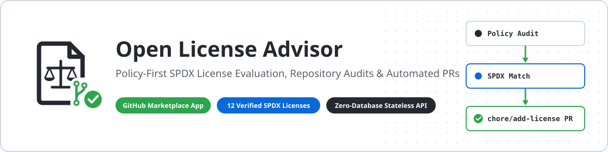
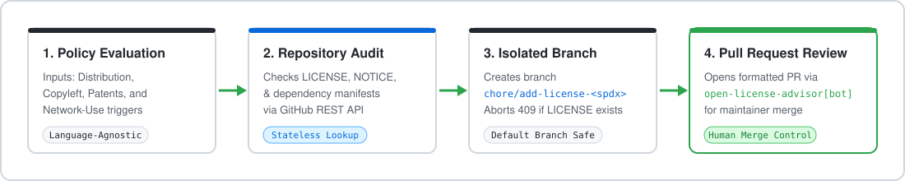

<div align="center">

<a href="https://github.com/marketplace/open-license-advisor">
  
</a>

<br>

[](https://github.com/marketplace/open-license-advisor)
[](https://github.com/apps/open-license-advisor)
[](https://license-advisor.onrender.com)
[](./LICENSE)
[](https://nodejs.org/)

<p>
  <a href="https://license-advisor.onrender.com"><strong>Launch Web App</strong></a>
  &nbsp;&middot;&nbsp;
  <a href="https://github.com/apps/open-license-advisor"><strong>Install GitHub App</strong></a>
  &nbsp;&middot;&nbsp;
  <a href="https://github.com/marketplace/open-license-advisor"><strong>Marketplace Listing</strong></a>
  &nbsp;&middot;&nbsp;
  <a href="https://license-advisor.onrender.com/app-install.html"><strong>Automated PR Flow</strong></a>
  &nbsp;&middot;&nbsp;
  <a href="#local-development--self-hosting"><strong>Self-Host</strong></a>
</p>

</div>

---

## Purpose & Why Open License Advisor

<table>
  <tr>
    <td width="128" align="center" valign="middle">
      <a href="https://github.com/marketplace/open-license-advisor">
        
      </a>
    </td>
    <td valign="middle">
      <strong>Open License Advisor</strong> (<code>open-license-advisor[bot]</code>) is a deterministic open-source license recommendation tool, repository license inspector, and least-privilege GitHub App. It evaluates project requirements against <strong>12 OSI-approved and FSF-libre SPDX licenses</strong>, inspects existing repositories for license files, and opens clean, isolated Pull Requests on <code>chore/add-license-&lt;spdx&gt;</code> with explicit opt-in for license replacement, without storing repository code.
    </td>
  </tr>
</table>

### Key Engineering Principles

- **Deterministic Policy Engine:** Recommendations, compatibility checks, and plain-language permission/condition/limitation summaries are driven by rule-based logic in shared ES modules (`public/js/catalog-data.js`, `public/js/engine.js`, `public/js/generator.js`), eliminating black-box variance.
- **GitHub App Automation:** Adds a license on an isolated `chore/add-license-<spdx-lower>` branch. Existing licenses are protected by default. Choose **Replace existing license** to update the existing file on `chore/replace-license-<spdx-lower>` and open a documented PR. Repositories with multiple license files require manual review.
- **Stateless & Database-Free:** Runs with zero external database dependencies, using bounded in-memory webhook replay deduplication and strict Helmet Content Security Policy (CSP) headers.
- **Single Source of Truth:** Frontend vanilla HTML/JS pages and Node.js Express services import the exact same SPDX catalog, engine, and template generator modules.

---

## Public URLs & Live Endpoints Directory

| Resource | Public URL | Description |
| :--- | :--- | :--- |
| **GitHub Marketplace Listing** | [github.com/marketplace/open-license-advisor](https://github.com/marketplace/open-license-advisor) | Official GitHub Marketplace Free plan listing |
| **GitHub App Installation** | [github.com/apps/open-license-advisor](https://github.com/apps/open-license-advisor) | Install `open-license-advisor[bot]` on personal or org repositories |
| **Live Web Application** | [license-advisor.onrender.com](https://license-advisor.onrender.com) | Main web advisor, explorer, questionnaire, and comparison UI |
| **Automated PR UI** | [license-advisor.onrender.com/app-install.html](https://license-advisor.onrender.com/app-install.html) | Web interface to trigger and preview automated `LICENSE` Pull Requests |
| **API Health Check** | [license-advisor.onrender.com/api/health](https://license-advisor.onrender.com/api/health) | Live JSON status, configuration flags, and catalog count |
| **Privacy Policy** | [license-advisor.onrender.com/privacy.html](https://license-advisor.onrender.com/privacy.html) | Zero-persistence data handling and privacy commitments |
| **Support & Help** | [license-advisor.onrender.com/support.html](https://license-advisor.onrender.com/support.html) | User support channels and troubleshooting references |
| **Source Repository** | [github.com/ayushcmd/license-advisor](https://github.com/ayushcmd/license-advisor) | Full Apache-2.0-licensed source code, tests, and documentation |

---

## How It Works

<div align="center">
  
</div>

1. **Stage 1 — Policy Evaluation:** Developers answer clear licensing questions (commercial use, patent grant expectations, copyleft boundary, and network SaaS obligations). The deterministic engine scores and ranks matching SPDX licenses with transparent rules.
2. **Stage 2 — Repository Audit:** Before generating changes, the analyzer inspects `owner/repo` via the GitHub API (public API or installed `@octokit/app` installation token) to check the default branch for an existing `LICENSE` or `LICENSE.md` file.
3. **Stage 3 — Isolated Branch:** If no license exists, `prService` exchanges the App private key for a short-lived installation token and creates a dedicated feature branch (`chore/add-license-<spdx-lower>`), leaving the repository default branch untouched.
4. **Stage 4 — Pull Request Review:** `generator.js` formats the verified SPDX license text with the specified copyright year and holder, commits `LICENSE` via the GitHub Contents API, and opens a Pull Request summarizing permissions, conditions, limitations, and the official SPDX identifier.

---

## Detailed How-To-Use Guide

### Workflow 1: Interactive License Exploration, Questionnaire & Comparison

1. Open **[license-advisor.onrender.com](https://license-advisor.onrender.com)** (or your local instance at `http://localhost:3000`).
2. Browse all 12 curated licenses in **`explorer.html`** to inspect permissions, conditions, limitations, patent grants, and network-use triggers.
3. Complete the guided policy assessment in **`questionnaire.html`** to receive ranked recommendations tailored to your project goals.
4. Open **`compare.html`** to evaluate multiple candidate licenses side by side, customize copyright year and holder fields, and preview or download the generated `LICENSE` file.

### Workflow 2: On-Demand Repository Inspection

1. Open **`analyzer.html`** (or invoke `POST /api/analyze` directly).
2. Enter any target repository as `owner/repo` (or full GitHub URL).
3. Inspect the repository's default branch status to verify whether a `LICENSE` or `LICENSE.md` file is already present before requesting a Pull Request.

```bash
curl -s -X POST https://license-advisor.onrender.com/api/analyze \
  -H "Content-Type: application/json" \
  -d '{"repo":"ayushcmd/license-advisor"}'
```

### Workflow 3: Automated Pull Request Creation via GitHub App

1. Install **Open License Advisor** from **[github.com/apps/open-license-advisor](https://github.com/apps/open-license-advisor)** (or the **[GitHub Marketplace](https://github.com/marketplace/open-license-advisor)**) and grant access to one or more repositories.
2. Open **[license-advisor.onrender.com/app-install.html](https://license-advisor.onrender.com/app-install.html)** (or invoke `POST /api/trigger-pr`).
3. Provide the target `owner/repo`, choose your SPDX license identifier (e.g., `MIT` or `Apache-2.0`), copyright year, and copyright holder name.
4. Choose **Add new license** or **Replace existing license**, then submit to open a ready-to-review Pull Request. Replacement preserves the existing filename (such as `LICENSE.md` or `COPYING`) and updates it only on a feature branch. Review the diff before merging. API clients opt in with `replaceExisting: true`; omitting it keeps existing licenses protected.

```bash
curl -s -X POST https://license-advisor.onrender.com/api/trigger-pr \
  -H "Content-Type: application/json" \
  -d '{"repo":"owner/repo","licenseId":"MIT","year":"2026","holder":"Your Name"}'
```

### REST API & Shared Module Reference

| Endpoint | Method | Purpose | Request / Notes |
| :--- | :--- | :--- | :--- |
| `/api/health` | `GET` | Health & readiness check | Returns `{ status, service, mode, timestamp, githubAppConfigured, webhookConfigured, catalogCount }` |
| `/api/config` | `GET` | Public App configuration | Returns App slug, install URL, `planTier`, `supportedPermissions`, `spdxCatalogVersion`, and `licenseCount` |
| `/api/recommend` | `POST` | Deterministic recommendation | Validates questionnaire policy payload and returns ranked SPDX recommendations |
| `/api/analyze` | `POST` | Repository license inspection | Body: `{ "repo": "owner/repo" }` — works on public repos and App-installed private repos |
| `/api/trigger-pr` | `POST` | Automated `LICENSE` Pull Request | Body: `{ "repo", "licenseId", "year", "holder" }` — returns HTTP `201` with PR URL/number or `409` if licensed |
| `/api/webhooks` | `POST` | Signed GitHub App webhook intake | Verifies `X-Hub-Signature-256` on raw body; handles `ping`, `installation`, `installation_repositories`, `repository` |

> **Note on Catalog & Comparison:** Full SPDX catalog inspection (`public/js/catalog-data.js`) and side-by-side comparison logic (`compareLicenses` in `public/js/engine.js`) execute directly via shared ES6 modules with zero server round-trips required.

---

## Core Features & Verified SPDX Catalog

- **12 Verified SPDX Licenses:** Curated set covering permissive, weak-copyleft, strong-copyleft, network-copyleft, and public-domain dedication models.
- **Template Placeholder Injection:** Accurately populates copyright `[year]` and `[fullname]` / holder lines across official SPDX license bodies (`generator.js`).
- **GitHub-Native Accessible UI:** High-contrast light theme (`#FFFFFF` / `#24292F` / `#0969DA` / `#1F883D`), keyboard navigable controls, and zero third-party analytics trackers.
- **Compatibility Guidance:** Highlights patent-grant differences, file- vs. library- vs. work-level copyleft boundaries, and AGPL network triggers.

### Verified SPDX License Matrix

| SPDX Identifier | Official Name | Category | Copyleft Strength / Scope | Patent Grant | Network Use Trigger |
| :--- | :--- | :--- | :--- | :--- | :--- |
| `MIT` | MIT License | `permissive` | `none` / `none` | `none` | `false` |
| `ISC` | ISC License | `permissive` | `none` / `none` | `none` | `false` |
| `BSD-2-Clause` | BSD 2-Clause "Simplified" License | `permissive` | `none` / `none` | `none` | `false` |
| `BSD-3-Clause` | BSD 3-Clause "New" or "Revised" License | `permissive` | `none` / `none` | `none` | `false` |
| `Apache-2.0` | Apache License 2.0 | `permissive` | `none` / `none` | `explicit` | `false` |
| `MPL-2.0` | Mozilla Public License 2.0 | `weak-copyleft` | `weak` / `file` | `explicit` | `false` |
| `EPL-2.0` | Eclipse Public License 2.0 | `weak-copyleft` | `weak` / `module` | `explicit` | `false` |
| `LGPL-3.0-only` | GNU Lesser General Public License v3.0 only | `weak-copyleft` | `weak` / `library` | `explicit` | `false` |
| `GPL-2.0-only` | GNU General Public License v2.0 only | `strong-copyleft` | `strong` / `work` | `none` | `false` |
| `GPL-3.0-only` | GNU General Public License v3.0 only | `strong-copyleft` | `strong` / `work` | `explicit` | `false` |
| `AGPL-3.0-only` | GNU Affero General Public License v3.0 only | `network-copyleft` | `network` / `network` | `explicit` | `true` |
| `Unlicense` | The Unlicense | `public-domain` | `none` / `none` | `none` | `false` |

---

## Security, Privacy & Least-Privilege Model

### GitHub App Permissions

Open License Advisor requests only the minimum permissions required to inspect repository licensing state and open Pull Requests:

| Permission Scope | Access Level | Justification |
| :--- | :--- | :--- |
| **Metadata** | Read-only | Resolve repository default branch and basic repository metadata |
| **Contents** | Read & write | Check for existing `LICENSE` / `LICENSE.md`, create `chore/add-license-*` branch, and commit `LICENSE` |
| **Pull requests** | Read & write | Open documented Pull Requests referencing the generated branch |

### Defense-in-Depth Safeguards

- **Raw-Body HMAC-SHA256 Webhook Verification:** `src/server.js` preserves the raw request buffer for `/api/webhooks` so `@octokit/webhooks` strictly validates `X-Hub-Signature-256` before any payload is processed.
- **Replay & Duplicate Delivery Protection:** Tracks `X-GitHub-Delivery` UUIDs to prevent duplicate handling of replayed webhook deliveries.
- **Default-Branch Overwrite Prevention:** Never commits directly to `main` or the configured default branch; detects `LICENSE` or `LICENSE.md` beforehand and aborts safely with HTTP `409 Conflict`.
- **Zero-Secret & Zero-Code Persistence:** No database stores source files, access tokens, or repository snapshots. Private keys remain strictly in environment variables or untracked `.pem` files excluded by `.gitignore`.
- **Strict Content Security Policy:** Configured via `helmet` allowing only self-hosted styles and scripts.

For full threat modeling and architecture notes, read [docs/SECURITY.md](./docs/SECURITY.md) and [docs/ARCHITECTURE.md](./docs/ARCHITECTURE.md).

---

## Local Development & Self-Hosting

### Prerequisites

- **Node.js `>=20.0.0`** (verified with Node.js v24 LTS; see `package.json`)
- **npm**

### Quick Start

```bash
git clone https://github.com/ayushcmd/license-advisor.git
cd license-advisor
npm install
cp .env.example .env
npm test
npm start
```

Available npm scripts:

- `npm start` — Start the Express server (`src/server.js`)
- `npm run dev` — Run with Node file-watch mode (`node --watch src/server.js`)
- `npm test` — Execute the native `node:test` unit and integration suite (`tests/*.test.js`)
- `npm run lint:syntax` — Validate JavaScript module syntax across `src/` and `public/js/`

### Environment Variables (`.env.example`)

| Variable | Required | Default / Example | Description |
| :--- | :--- | :--- | :--- |
| `PORT` | No | `3000` | HTTP port bound by Express |
| `NODE_ENV` | No | `development` | Runtime mode (`development` or `production`) |
| `APP_URL` | No | `http://localhost:3000` | Public base URL used in config metadata and CORS defaults |
| `ALLOWED_ORIGINS` | No | *(empty)* | Comma-separated additional allowed CORS origins |
| `GITHUB_APP_ID` | For App PRs | *(empty)* | Numeric GitHub App ID for `@octokit/app` authentication |
| `GITHUB_APP_SLUG` | No | `license-advisor` | Public GitHub App URL slug |
| `GITHUB_WEBHOOK_SECRET` | For Webhooks | *(empty)* | Shared HMAC-SHA256 webhook secret (`X-Hub-Signature-256`) |
| `GITHUB_PRIVATE_KEY_PATH` | Optional | *(empty)* | Filesystem path to GitHub App `.pem` private key |
| `GITHUB_PRIVATE_KEY` | Optional | *(empty)* | Inline PEM private key (use `\n` escapes in single-line env vars) |
| `GITHUB_PUBLIC_TOKEN` | No | *(empty)* | Optional token to raise rate limits on public repo inspection |
| `WEBHOOK_PROXY_URL` | No | *(empty)* | Optional `smee.io` proxy URL for local webhook forwarding |

### Project Documentation Guides

- [docs/ARCHITECTURE.md](./docs/ARCHITECTURE.md) — Database-free modular architecture and shared ES module design
- [docs/DEVELOPMENT.md](./docs/DEVELOPMENT.md) — Local environment setup, test execution, and `smee.io` webhook forwarding
- [docs/GITHUB_APP_SETUP.md](./docs/GITHUB_APP_SETUP.md) — Registering the GitHub App, least-privilege permissions, and `.pem` setup
- [docs/MARKETPLACE_GUIDELINES.md](./docs/MARKETPLACE_GUIDELINES.md) — GitHub Marketplace submission checklist and Free plan compliance
- [docs/SECURITY.md](./docs/SECURITY.md) — Security architecture, HMAC verification, CSP policy, and secret hygiene

---

## Developer & Maintainer

Built and maintained by **Ayush Raj** (`@ayushcmd`).

[](https://github.com/ayushcmd)
[](https://www.linkedin.com/in/ayushcmd)
[](mailto:ayush_24a12res897@iitp.ac.in)

---

## License & Attribution

- **Project License:** Released under the **[Apache License 2.0](./LICENSE)** (`SPDX-License-Identifier: Apache-2.0`), `Copyright 2026 Ayush Raj (@ayushcmd)`.
- **Attribution & `NOTICE` Preservation:** Under Section 4 of the Apache License 2.0, downstream distributions and derivative works must:
  1. Include a copy of the root **[LICENSE](./LICENSE)** file.
  2. Retain all copyright, patent, trademark, and attribution notices from the source work.
  3. Preserve the attribution credit to **Ayush Raj (`@ayushcmd`)** in the root **[NOTICE](./NOTICE)** file (`Open License Advisor`, `Copyright 2026 Ayush Raj`).
  4. Carry prominent notices stating any modifications in changed files.
- **SPDX Attribution:** Standard SPDX identifiers and canonical license texts follow the [SPDX License List](https://spdx.org/licenses/) (SPDX License List Data is licensed under `CC0-1.0`).
- **Disclaimer:** Open License Advisor provides structured technical summaries based on SPDX metadata and deterministic policy rules. It does not constitute formal legal advice; consult qualified legal counsel for jurisdiction-specific or commercial compliance reviews.
